<picture>
  <source media="(prefers-color-scheme: dark)" srcset="./assets/header-dark.svg">
  <source media="(prefers-color-scheme: light)" srcset="./assets/header-light.svg">
  
</picture>

 

<a href="#sobre"><b>Sobre</b></a> &nbsp;·&nbsp;
<a href="#competências"><b>Competências</b></a> &nbsp;·&nbsp;
<a href="#stack"><b>Stack</b></a> &nbsp;·&nbsp;
<a href="#inteligência-artificial-aplicada"><b>IA aplicada</b></a> &nbsp;·&nbsp;
<a href="#contato"><b>Contato</b></a>

 

## Sobre

Desenvolvedor Full Stack e estudante de Engenharia de Software, com atuação prática na criação, manutenção e evolução de **sistemas empresariais em produção**.

Meu trabalho se concentra na camada onde os sistemas realmente se encontram: APIs REST, integrações entre plataformas, modelagem de dados, sistemas legados e infraestrutura Linux. Uso modelos de linguagem como parte do processo de engenharia — não como atalho, mas como ferramenta de leitura de código, documentação e automação.

O que me interessa não é a stack, é o problema por trás dela: entender a operação, localizar o gargalo e entregar algo que sustente carga real.

 

## Competências

<table>
<tr>
<td width="33%" valign="top">

**Aplicação**

Desenvolvimento Full Stack
APIs REST e integrações
Dashboards e painéis
Autenticação, JWT e permissões

</td>
<td width="33%" valign="top">

**Dados e infraestrutura**

Modelagem e otimização SQL
Servidores Linux e Nginx
Deploy, AWS e monitoramento
Containers com Docker

</td>
<td width="33%" valign="top">

**Sistemas e processos**

ERPs e sistemas empresariais
Diagnóstico de sistemas legados
Modernização e integração
Automação de processos

</td>
</tr>
</table>

 

## Stack

| Camada | Tecnologias |
| :--- | :--- |
| **Linguagens** | TypeScript · JavaScript · PHP · Python · C# |
| **Frontend** | React · Next.js · Vite · Tailwind CSS |
| **Backend** | Node.js · NestJS · Express · Laravel · Prisma |
| **Dados** | PostgreSQL · MySQL · MariaDB · Supabase · Redis |
| **Infraestrutura** | Linux (Arch, Ubuntu) · Docker · Nginx · AWS |
| **Ferramentas** | Git · GitHub · VS Code · Postman |

<b>Visualizar em ícones</b>

 

 

 

 

 

## Inteligência artificial aplicada

Uso de LLMs integrado ao ciclo de desenvolvimento, com escopo definido:

| Frente | Aplicação |
| :--- | :--- |
| **Sistemas legados** | Mapeamento de código sem documentação, análise de fluxo e dependências. |
| **Agentes especializados** | Assistentes por função, integrados às aplicações via API. |
| **Engenharia de prompts** | Prompts estruturados e versionados junto do código. |
| **Revisão de código** | Análise, correção e refatoração assistidas. |
| **Documentação** | Geração e manutenção de documentação técnica a partir do repositório. |
| **Arquitetura** | Apoio na análise de requisitos e no planejamento de sistemas. |
| **Automação** | Rotinas empresariais e fluxos operacionais com LLMs. |

 

> A IA acelera a escrita. A arquitetura, as decisões e a responsabilidade pelo que vai para produção continuam sendo minhas.

 

## Atividade

<picture>
  <source media="(prefers-color-scheme: dark)" srcset="https://github-readme-stats.vercel.app/api?username=DevMacedojr&show_icons=true&hide_border=true&hide_title=true&theme=transparent&icon_color=6C63FF&text_color=8B95A8&include_all_commits=true&count_private=true&locale=pt-br">
  
</picture>

<picture>
  <source media="(prefers-color-scheme: dark)" srcset="https://github-readme-stats.vercel.app/api/top-langs/?username=DevMacedojr&layout=compact&hide_border=true&hide_title=true&theme=transparent&text_color=8B95A8&langs_count=6&locale=pt-br">
  
</picture>

  

 

## Contato

  

Tecnologia não é apenas escrever código — é entender problemas reais e transformá-los em soluções escaláveis e funcionais.

